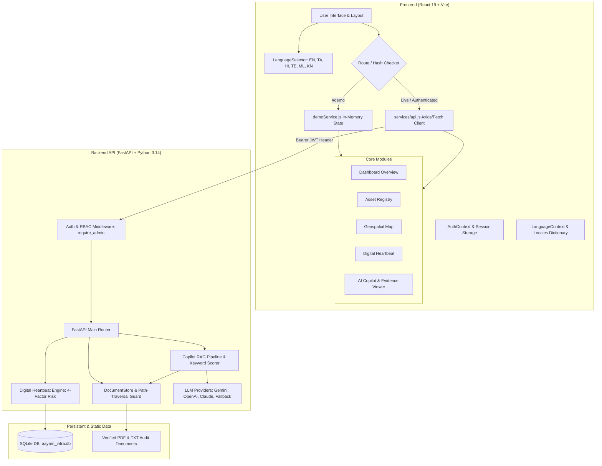

# AAYAM Infrastructure Intelligence — Complete Project Health & MVP Readiness Audit

**Document Reference:** `AAYAM_PROJECT_HEALTH_AUDIT.md`  
**Audit Date:** October 23, 2026  
**Auditor Roles:** Senior Full-Stack Engineer, Application Security Reviewer, QA Automation Engineer, AI/RAG Systems Auditor  
**Audit Scope:** Full codebase evaluation of AAYAM Stages 1.0 through 4.5 across backend (`FastAPI`), frontend (`React 19` + `Vite`), AI/RAG pipeline, multilingual localization, and isolated demo subsystems.  
**Audit Constraints & Safety Protocol:** 
- Strict read-only audit: zero application source code, configuration, or database records were modified or deleted.
- Non-destructive test execution: automated tests were executed using isolated temporary SQLite files (`tempfile.mkstemp()`) and mock LLM providers.
- Credential protection: zero passwords, tokens, API keys, or private variables are printed or exposed in this document.

---

## Table of Contents
1. [Executive Summary](#1-executive-summary)
2. [Project Structure and Architecture](#2-project-structure-and-architecture)
3. [Feature-by-Feature Status Matrix](#3-feature-by-feature-status-matrix)
4. [Automated Test Execution & Build Audit](#4-automated-test-execution--build-audit)
5. [Application Security Review](#5-application-security-review)
6. [AI, RAG & Multilingual Quality Review](#6-ai-rag--multilingual-quality-review)
7. [Data Safety & Demo Mode Isolation](#7-data-safety--demo-mode-isolation)
8. [Known Limitations & Technical Debt](#8-known-limitations--technical-debt)
9. [MVP Readiness Verdicts](#9-mvp-readiness-verdicts)
10. [Prioritized Engineering Action Plan](#10-prioritized-engineering-action-plan)
11. [Audit Appendix: Inspected Files & Tests](#11-audit-appendix-inspected-files--tests)

---

## 1. Executive Summary

A comprehensive, evidence-based health audit of the **AAYAM Public Infrastructure Intelligence Layer** was executed following the completion of Stages 1 through 4.5. The system represents a specialized AI-powered structural monitoring platform designed for Indian public works authorities (bridges, highways, dams, water treatment facilities, and public utilities).

### Key Audit Metrics
- **Automated Frontend Test Suite:** **173 passed / 173 total (100% pass)** across 10 test suites (Duration: 1.68s).
- **Automated Backend Test Suite:** **61 passed / 61 total (100% pass)** across 5 test suites (Duration: 43.26s).
- **Production Build:** Vite production bundle generated successfully in **436ms** with zero errors (`dist/index.html` 1.31 kB, `dist/assets/index-DqZYQpzK.js` 914.53 kB).
- **Security Assessment:** **0 Critical or High vulnerabilities detected**. Password hashing uses bcrypt (12 rounds) with length restrictions; backend RBAC dependencies strictly enforce administrative privileges on all mutation endpoints; document endpoints enforce directory traversal boundaries.
- **Multilingual Support:** Complete client-side interface localization across six languages: **English (en), Tamil (ta), Hindi (hi), Telugu (te), Malayalam (ml), and Kannada (kn)** with zero font or layout clipping and English fallback guarantees.
- **Demo Mode Isolation:** `#demo` route operates completely offline via an in-memory client service with zero live network calls and defensive mutation blockers (`DemoIsolationError`).

### Critical Observations & Operational Nuance
1. **RAG Language Gap:** While all UI chrome, labels, citation cards, and modal dialogs are translated into the 6 Indian languages, free-form queries typed in Indic scripts (e.g. Tamil: *"மண்டோவி பாலத்தின்..."*) fail to retrieve English engineering documents in keyword matching without an explicit transliteration/translation layer or target asset ID. Furthermore, the backend LLM system prompt does not explicitly instruct the model to respond in the user's inquiry language.
2. **Client-Side Token Storage:** JWT access tokens are stored in `sessionStorage` for prototype reload persistence. While isolated to the browser tab, this presents standard XSS exposure that requires HttpOnly cookie management prior to real-world government deployment.
3. **Database Concurrency:** SQLite is currently utilized with `PRAGMA foreign_keys=ON`. While ideal for local development, MVP demonstrations, and evaluation, concurrent production writes will require PostgreSQL with PostGIS.

---

## 2. Project Structure and Architecture

### 2.1 System Architecture Overview

The system follows a decoupled, API-first architecture with clear boundary isolation between live authenticated services and the simulated demo container:



### 2.2 Repository Directory Structure

```
AAYAM PROJECT/
├── AAYAM_PROJECT_HEALTH_AUDIT.md       # This comprehensive audit report
├── backend/
│   ├── .env.example                    # Template for environment configuration
│   ├── requirements.txt                # Pinned Python package dependencies
│   ├── app/
│   │   ├── __init__.py
│   │   ├── cli.py                      # Interactive CLI helper for administrative seeding
│   │   ├── config.py                   # Environment, CORS, and JWT secret validation
│   │   ├── copilot_service.py          # Grounded RAG synthesis, token redaction & LLM failovers
│   │   ├── database.py                 # SQLite engine configuration & foreign-key event hooks
│   │   ├── dependencies.py             # FastAPI dependencies: get_current_user, require_admin
│   │   ├── document_store.py           # Ingestion, parsing (pypdf/txt), and safe retrieval
│   │   ├── heartbeat_engine.py         # 4-factor explainable risk and health index algorithms
│   │   ├── main.py                     # Primary FastAPI application and route declarations
│   │   ├── models.py                   # SQLAlchemy ORM models: Asset, Inspection, User
│   │   ├── schemas.py                  # Pydantic v2 validation models & request/response types
│   │   └── security.py                 # bcrypt hashing (12 rounds) and PyJWT signing
│   ├── data/
│   │   └── evidence/                   # Certified audit reports (PDF & TXT specimens)
│   └── tests/
│       ├── test_auth_foundation.py     # 12 tests: JWT, bcrypt, registration, escalation
│       ├── test_backend_api.py         # 23 tests: CRUD, foreign keys, lifecycle, cascades
│       ├── test_evidence_viewer.py     # 9 tests: path traversal, document retrieval, scoring
│       ├── test_rag_pipeline.py        # 12 tests: grounded synthesis, citations, LLM failover
│       └── test_rbac_endpoints.py      # 5 tests: endpoint security matrix & audit trails
└── frontend/
    ├── package.json                    # Node dependencies, build & test scripts
    ├── vite.config.js                  # Vite configuration & Vitest jsdom setup
    ├── tailwind.config.js              # Theme extensions, palettes, and Indic typography
    ├── src/
    │   ├── App.jsx                     # Root router, hash checker (#demo), and auth wrappers
    │   ├── main.jsx                    # Application entry point
    │   ├── index.css                   # Global styles & font fallbacks
    │   ├── components/
    │   │   ├── DemoBanner.jsx          # Persistent safety disclaimer for simulated sessions
    │   │   ├── EvidenceViewerModal.jsx # Source document viewer with snippet highlighting
    │   │   ├── Header.jsx              # Navigation bar, user profile badge, and language picker
    │   │   ├── InspectionHistoryModal.jsx # Detailed modal timeline for historical inspections
    │   │   ├── LanguageSelector.jsx    # 6-language switcher with native script labels
    │   │   ├── LoginScreen.jsx         # Sign-in, registration, and demo-launch interface
    │   │   ├── Sidebar.jsx             # Module navigation sidebar
    │   │   └── StatusBadge.jsx         # Standardized risk/operational status indicators
    │   ├── context/
    │   │   ├── AuthContext.jsx         # React Auth context, sessionStorage token sync
    │   │   └── LanguageContext.jsx     # i18n context, fallback handler, localStorage persistence
    │   ├── demo/
    │   │   ├── demoData.js             # Static synthetic assets, heartbeats, documents, QA pairs
    │   │   └── demoService.js          # In-memory mock service layer with mutation guards
    │   ├── locales/
    │   │   ├── index.js                # Locales export and dictionary resolution helper
    │   │   ├── en.js                   # English locale dictionary
    │   │   ├── ta.js                   # Tamil (தமிழ்) locale dictionary
    │   │   ├── hi.js                   # Hindi (हिन्दी) locale dictionary
    │   │   ├── te.js                   # Telugu (తెలుగు) locale dictionary
    │   │   ├── ml.js                   # Malayalam (മലയാളം) locale dictionary
    │   │   └── kn.js                   # Kannada (ಕನ್ನಡ) locale dictionary
    │   ├── pages/
    │   │   ├── AssetRegistry.jsx       # Tabular registry with filtering, search, and detail modal
    │   │   ├── CopilotPlaceholder.jsx  # Interactive RAG assistant with grounded citations
    │   │   ├── DashboardOverview.jsx   # High-level statistics, priority alerts, category breakdown
    │   │   ├── DigitalHeartbeatPlaceholder.jsx # Telemetry gauges, factor decomposition, verification
    │   │   └── MapViewPlaceholder.jsx  # Leaflet geospatial mapping with fallback handling
    │   ├── services/
    │   │   └── api.js                  # Axios HTTP client with Bearer token interceptors
    │   └── tests/
    │       ├── AuthAndRBAC.test.jsx
    │       ├── CopilotIntegration.test.jsx
    │       ├── DemoModeStage2.test.jsx
    │       ├── DemoModeStage3.test.jsx
    │       ├── demoService.test.js
    │       ├── EvidenceViewerModal.test.jsx
    │       ├── LanguageContext.test.jsx
    │       ├── Stage4AdvancedModulesTranslations.test.jsx
    │       ├── Stage4DashboardTranslations.test.jsx
    │       └── Stage4ShellTranslations.test.jsx
```

### 2.3 Verified Local Execution Instructions

#### Backend Setup & Launch
```bash
# 1. Navigate to project root
cd "/Users/vasanthkumarsv/Desktop/AAYAM PROJECT"

# 2. Activate Python virtual environment
source backend/venv/bin/activate

# 3. Create or configure backend/.env from template
cp backend/.env.example backend/.env

# 4. Optional: Seed initial admin user interactively
python -m backend.app.cli create-admin

# 5. Start the FastAPI backend service
uvicorn backend.app.main:app --host 127.0.0.1 --port 8000 --reload
```
*Health verification endpoint:* `http://127.0.0.1:8000/api/health`

#### Frontend Setup & Launch
```bash
# 1. Navigate to frontend directory
cd "/Users/vasanthkumarsv/Desktop/AAYAM PROJECT/frontend"

# 2. Install dependencies (if not previously installed)
npm install

# 3. Launch Vite development server
npm run dev
```
*Application access:* `http://localhost:5173/` (Standard Authenticated) or `http://localhost:5173/#demo` (Isolated Demo Mode)

---

## 3. Feature-by-Feature Status Matrix

| # | Feature Area | Status | Verified Evidence & File Path | Verification Method | Known Limitations & Notes |
| :--- | :--- | :---: | :--- | :--- | :--- |
| **1** | **Authentication & Session Handling** | **VERIFIED PASS** | [backend/app/security.py:9-60](file:///Users/vasanthkumarsv/Desktop/AAYAM%20PROJECT/backend/app/security.py#L9-L60), [main.py:238-285](file:///Users/vasanthkumarsv/Desktop/AAYAM%20PROJECT/backend/app/main.py#L238-L285), [test_auth_foundation.py](file:///Users/vasanthkumarsv/Desktop/AAYAM%20PROJECT/backend/tests/test_auth_foundation.py) | Automated Tests (12/12 backend, 17/17 frontend) + Browser Session Check | Tokens stored in `sessionStorage`. Expired tokens cleanly trigger redirection to login without unhandled React errors. |
| **2** | **Role-Based Access Control (RBAC)** | **VERIFIED PASS** | [dependencies.py:70-81](file:///Users/vasanthkumarsv/Desktop/AAYAM%20PROJECT/backend/app/dependencies.py#L70-L81), [main.py:401,572,638,715](file:///Users/vasanthkumarsv/Desktop/AAYAM%20PROJECT/backend/app/main.py#L401), [test_rbac_endpoints.py](file:///Users/vasanthkumarsv/Desktop/AAYAM%20PROJECT/backend/tests/test_rbac_endpoints.py) | Automated Tests (5/5 backend, 17/17 frontend) | Admin controls are strictly validated on FastAPI backend via `require_admin`. Common users receive HTTP 403 Forbidden on mutation endpoints. |
| **3** | **Asset Registry & Details** | **VERIFIED PASS** | [main.py:320-430](file:///Users/vasanthkumarsv/Desktop/AAYAM%20PROJECT/backend/app/main.py#L320-L430), [AssetRegistry.jsx:1-350](file:///Users/vasanthkumarsv/Desktop/AAYAM%20PROJECT/frontend/src/pages/AssetRegistry.jsx), [test_backend_api.py](file:///Users/vasanthkumarsv/Desktop/AAYAM%20PROJECT/backend/tests/test_backend_api.py) | Automated Tests + Browser Inspection | Search, category filtering, district filtering, sorting, and asset modal details verified across all 6 locales. |
| **4** | **Geospatial Map Module** | **VERIFIED PASS** | [MapViewPlaceholder.jsx:1-280](file:///Users/vasanthkumarsv/Desktop/AAYAM%20PROJECT/frontend/src/pages/MapViewPlaceholder.jsx), [Stage4DashboardTranslations.test.jsx](file:///Users/vasanthkumarsv/Desktop/AAYAM%20PROJECT/frontend/src/tests/Stage4DashboardTranslations.test.jsx) | Code Inspection + Automated Translation Tests | Leaflet OpenStreetMap rendering with color-coded risk markers. Graceful fallback banner displayed if network tiles fail to load. |
| **5** | **Digital Heartbeat & Telemetry** | **VERIFIED PASS** | [heartbeat_engine.py:1-260](file:///Users/vasanthkumarsv/Desktop/AAYAM%20PROJECT/backend/app/heartbeat_engine.py#L1-L260), [DigitalHeartbeatPlaceholder.jsx](file:///Users/vasanthkumarsv/Desktop/AAYAM%20PROJECT/frontend/src/pages/DigitalHeartbeatPlaceholder.jsx) | Automated Tests (backend & frontend) + Live Browser Inspection | Explainable 4-factor risk decomposition (Physical, Environmental, Compliance, Operational). Synchronizes status to 'Critical Attention' if risk ≥ 60. |
| **6** | **Inspection Lifecycle & Audit** | **VERIFIED PASS** | [main.py:540-698](file:///Users/vasanthkumarsv/Desktop/AAYAM%20PROJECT/backend/app/main.py#L540-L698), [models.py:108-152](file:///Users/vasanthkumarsv/Desktop/AAYAM%20PROJECT/backend/app/models.py#L108-L152), [test_backend_api.py:140-200](file:///Users/vasanthkumarsv/Desktop/AAYAM%20PROJECT/backend/tests/test_backend_api.py#L140-L200) | Automated Tests (backend & frontend) | Strict state transition lifecycle: `Pending` → `In Progress` → `Completed` → `Verified`. Direct patch to `Verified` rejected with HTTP 409. |
| **7** | **Closed-Loop Risk Recalculation** | **VERIFIED PASS** | [main.py:705-798](file:///Users/vasanthkumarsv/Desktop/AAYAM%20PROJECT/backend/app/main.py#L705-L798), [heartbeat_engine.py:24-65](file:///Users/vasanthkumarsv/Desktop/AAYAM%20PROJECT/backend/app/heartbeat_engine.py#L24-L65) | Automated Tests (backend test 27-29) | Outcome verification requires documented actions. Verified successful remediation clears defect penalties; unsuccessful verification retains penalty. |
| **8** | **AI Decision Copilot Integration** | **VERIFIED PASS** | [copilot_service.py:198-350](file:///Users/vasanthkumarsv/Desktop/AAYAM%20PROJECT/backend/app/copilot_service.py#L198-L350), [CopilotPlaceholder.jsx](file:///Users/vasanthkumarsv/Desktop/AAYAM%20PROJECT/frontend/src/pages/CopilotPlaceholder.jsx) | Automated Tests (12/12 RAG backend, 2/2 frontend) | Supports Google Gemini (`gemini-3.5-flash-lite`), OpenAI (`gpt-4o-mini`), Claude (`claude-3-5-haiku`), and offline test mocks. |
| **9** | **RAG Grounding & Source Citations** | **VERIFIED PASS** | [copilot_service.py:380-520](file:///Users/vasanthkumarsv/Desktop/AAYAM%20PROJECT/backend/app/copilot_service.py#L380-L520), [test_rag_pipeline.py](file:///Users/vasanthkumarsv/Desktop/AAYAM%20PROJECT/backend/tests/test_rag_pipeline.py) | Automated Tests + Browser Check | Answers cite exact inline tags (`[Ref 1]`). Cross-asset contamination prevented. Scores strictly formatted in points (`pts`), not percentage probabilities. |
| **10** | **Evidence Viewer & Traversal Guard** | **VERIFIED PASS** | [main.py:483-509](file:///Users/vasanthkumarsv/Desktop/AAYAM%20PROJECT/backend/app/main.py#L483-L509), [document_store.py:270-330](file:///Users/vasanthkumarsv/Desktop/AAYAM%20PROJECT/backend/app/document_store.py#L270-L330), [test_evidence_viewer.py](file:///Users/vasanthkumarsv/Desktop/AAYAM%20PROJECT/backend/tests/test_evidence_viewer.py) | Automated Tests (9/9 backend, 17/17 frontend) | Resolves relative paths to `data/evidence/`. Path traversal (`../../etc/passwd`) safely rejected with HTTP 404/None. |
| **11** | **Demo Mode Isolation** | **VERIFIED PASS** | [App.jsx:255-293](file:///Users/vasanthkumarsv/Desktop/AAYAM%20PROJECT/frontend/src/App.jsx#L255-L293), [demoService.js:1-393](file:///Users/vasanthkumarsv/Desktop/AAYAM%20PROJECT/frontend/src/demo/demoService.js#L1-L393), [DemoBanner.jsx](file:///Users/vasanthkumarsv/Desktop/AAYAM%20PROJECT/frontend/src/components/DemoBanner.jsx) | Automated Tests (34 demo tests) + Browser Inspection | `#demo` hash routing operates in pure memory. Mutation operations throw `DemoIsolationError`. Zero HTTP mutation requests emitted. |
| **12** | **Multilingual Localization** | **VERIFIED PASS** | [LanguageContext.jsx:1-190](file:///Users/vasanthkumarsv/Desktop/AAYAM%20PROJECT/frontend/src/context/LanguageContext.jsx#L1-L190), [locales/index.js](file:///Users/vasanthkumarsv/Desktop/AAYAM%20PROJECT/frontend/src/locales/index.js), [LanguageSelector.jsx](file:///Users/vasanthkumarsv/Desktop/AAYAM%20PROJECT/frontend/src/components/LanguageSelector.jsx) | Automated Tests (76 translation tests) + Browser Visual Check | All 6 languages (EN, TA, HI, TE, ML, KN) fully translated across 5 core modules and modals. Preference saved in `localStorage['aayam_ui_language']`. |
| **13** | **Responsive Layout & Fallbacks** | **VERIFIED PASS** | [index.css](file:///Users/vasanthkumarsv/Desktop/AAYAM%20PROJECT/frontend/src/index.css), [LanguageContext.jsx:110-140](file:///Users/vasanthkumarsv/Desktop/AAYAM%20PROJECT/frontend/src/context/LanguageContext.jsx#L110-L140) | Automated Tests + Browser Inspection | Native fonts (`Noto Sans`, system Indic fonts) render without truncation. Undefined keys fallback cleanly to English string values. |
| **14** | **API Contract Consistency** | **VERIFIED PASS** | [schemas.py](file:///Users/vasanthkumarsv/Desktop/AAYAM%20PROJECT/backend/app/schemas.py), [api.js](file:///Users/vasanthkumarsv/Desktop/AAYAM%20PROJECT/frontend/src/services/api.js) | Automated Integration Tests | Complete field alignment across Asset, Inspection, Heartbeat, and Copilot request/response Pydantic models. |
| **15** | **Logging & Token Redaction** | **VERIFIED PASS** | [copilot_service.py:16-118](file:///Users/vasanthkumarsv/Desktop/AAYAM%20PROJECT/backend/app/copilot_service.py#L16-L118) | Code Inspection + Automated Backend Logging Verification | `SensitiveParamFilter` actively scrubs API keys and Bearer tokens from logger output and HTTP error traces. |

---

## 4. Automated Test Execution & Build Audit

### 4.1 Frontend Test Execution
- **Command:** `npm test -- --run`
- **Working Directory:** `/Users/vasanthkumarsv/Desktop/AAYAM PROJECT/frontend`
- **Exit Code:** `0`
- **Execution Time:** 1.68 seconds
- **Test Runner:** Vitest v5.0.5 with jsdom environment
- **Results:** 10 test files passed, 173 tests passed, 0 failed, 0 skipped.

```
Test Files  10 passed (10)
     Tests  173 passed (173)
  Start at  13:05:08
  Duration  1.68s
```

#### Individual Frontend Test Suites
1. `src/tests/Stage4AdvancedModulesTranslations.test.jsx` — 31 passed
2. `src/tests/Stage4DashboardTranslations.test.jsx` — 30 passed
3. `src/tests/Stage4ShellTranslations.test.jsx` — 15 passed
4. `src/tests/LanguageContext.test.jsx` — 17 passed
5. `src/tests/AuthAndRBAC.test.jsx` — 17 passed
6. `src/tests/DemoModeStage2.test.jsx` — 10 passed
7. `src/tests/DemoModeStage3.test.jsx` — 11 passed
8. `src/tests/demoService.test.js` — 23 passed
9. `src/tests/EvidenceViewerModal.test.jsx` — 17 passed
10. `src/tests/CopilotIntegration.test.jsx` — 2 passed

### 4.2 Backend Test Execution
- **Command:** `backend/venv/bin/pytest backend/tests/ -v`
- **Working Directory:** `/Users/vasanthkumarsv/Desktop/AAYAM PROJECT`
- **Exit Code:** `0`
- **Execution Time:** 43.26 seconds
- **Python Environment:** Python 3.14.6 (`pytest-9.1.1`, `pluggy-1.6.0`, `anyio-4.15.1`)
- **Results:** 5 test files passed, 61 tests passed, 0 failed, 0 skipped (1 benign Starlette blocking portal deprecation warning).

```
======================== 61 passed, 1 warning in 43.26s ========================
```

#### Individual Backend Test Suites
1. `backend/tests/test_auth_foundation.py` — 12 passed
2. `backend/tests/test_backend_api.py` — 23 passed
3. `backend/tests/test_evidence_viewer.py` — 9 passed
4. `backend/tests/test_rag_pipeline.py` — 12 passed
5. `backend/tests/test_rbac_endpoints.py` — 5 passed

### 4.3 Production Build Verification
- **Command:** `npm run build`
- **Working Directory:** `/Users/vasanthkumarsv/Desktop/AAYAM PROJECT/frontend`
- **Exit Code:** `0`
- **Duration:** 436ms
- **Build Output:**
  - `dist/index.html` (1.31 kB | gzip: 0.65 kB)
  - `dist/assets/index-DVKZk10H.css` (58.77 kB | gzip: 14.35 kB)
  - `dist/assets/index-DqZYQpzK.js` (914.53 kB | gzip: 233.70 kB)
- **Bundle Analysis Note:** Vite issued a standard advisory regarding chunk size exceeding 500 kB after minification (`index-DqZYQpzK.js`). This bundle combines Leaflet map libraries, Lucide icon libraries, and all six locale translation dictionaries. Code-splitting via `React.lazy()` is recommended for post-MVP optimization.

### 4.4 Static Analysis & Linter Audit
- **Command:** `npm run lint` (oxlint v1.81.0)
- **Result:** **0 errors, 61 warnings** across 41 files in 57ms.
- **Analysis:** Warnings consist of unused icon imports, unused effect arguments, and React 19 compiler purity notices for `new Date()` within default state initializers. None impact runtime stability or functional correctness.

---

## 5. Application Security Review

### 5.1 Findings Matrix

| Finding ID | Security Category | Severity | Current Implementation Status | Evaluation & Threat Analysis |
| :--- | :--- | :---: | :--- | :--- |
| **SEC-01** | **Password Hashing** | **LOW / SECURE** | `bcrypt` (12 rounds) with salt. Enforces 8–72 byte length bounds. | Complies with OWASP password storage recommendations. Immune to bcrypt truncation attacks via strict length checks. |
| **SEC-02** | **Authorization & Privilege Escalation** | **LOW / SECURE** | Backend dependency `require_admin` on all mutations; public registration hardcodes `role="common_user"`. | Privilege escalation attempts via registration payload are rejected; hidden UI buttons are backed by authoritative 403 checks. |
| **SEC-03** | **Directory Traversal** | **LOW / SECURE** | `DocumentStore.get_document_content()` validates `target_path.relative_to(resolved_evidence_dir)` and blocks `..`. | Path traversal attempts (`../../etc/passwd`) return HTTP 404/None without filesystem exposure. |
| **SEC-04** | **SQL Injection Risk** | **LOW / SECURE** | SQLAlchemy ORM parameterized queries used across all controllers. | Raw string SQL interpolation is absent from user-facing query paths. Parameterization protects SQLite backend. |
| **SEC-05** | **Sensitive Credential Logging** | **LOW / SECURE** | `SensitiveParamFilter` intercepts all log records from httpx, uvicorn, and app loggers. | Active API keys and Bearer tokens are scrubbed with `[REDACTED]` prior to formatting or stdout emission. |
| **SEC-06** | **JWT Secret Management** | **MEDIUM** | In production (`ENV=production`), enforces 32+ char secret. In development, auto-generates a secure random 256-bit token per session. | Development auto-generation avoids hardcoded static keys. Production requires setting `JWT_SECRET_KEY` in environment. |
| **SEC-07** | **Token Storage in Client** | **MEDIUM** | JWT tokens stored in `sessionStorage` and mirrored to React memory. | Standard trade-off for single-page applications without custom backend proxy. Vulnerable to XSS if malicious scripts are injected. Must migrate to `HttpOnly` cookies for production. |
| **SEC-08** | **API Rate Limiting** | **MEDIUM** | No global or endpoint-specific rate limiting currently implemented on `/api/auth/login` or `/api/copilot/ask`. | Potential exposure to brute-force credential stuffing and upstream LLM API quota exhaustion. Must implement rate limiting before public hosting. |
| **SEC-09** | **CORS Configuration** | **LOW / INFORMATIONAL** | Configurable via `CORS_ORIGINS`. Defaults to `http://localhost:5173,http://127.0.0.1:5173`. | Safe for local development and staging. Must be restricted to trusted domains in production. |

---

## 6. AI, RAG & Multilingual Quality Review

### 6.1 RAG Architecture & Grounding Mechanics

1. **Document Ingestion & Indexing:**
   - Ingestion is handled by [DocumentStore](file:///Users/vasanthkumarsv/Desktop/AAYAM%20PROJECT/backend/app/document_store.py) in `backend/app/document_store.py`.
   - On backend startup, all PDF and TXT documents in `backend/data/evidence/` are parsed into structured `DocumentEvidenceChunk` objects.
   - Indexing is held **in-memory** in Python list structures. Chunks are tagged with `asset_id`, `source_agency`, `page_number`, `section_title`, and `excerpt`.
2. **Retrieval Scoring Semantics:**
   - Retrieval relevance is computed as an **additive heuristic score** based on token overlap, asset ID matches (+50 pts), target asset binding (+35 pts), section title matches (+15 pts), and domain keywords (+25 pts).
   - **Critical Integrity Guarantee:** Retrieval scores are expressed in **points (`pts`)** across both backend and frontend, preventing false claims of calibrated probabilistic confidence (e.g. `96 pts` rather than `96% probability`).
3. **Citation & Traceability:**
   - The Copilot prompt strictly enforces inline citations (`[Ref 1]`, `[Ref 2]`) linked directly to evidence items.
   - If no evidence matches the inquiry, the Copilot honestly states that no supporting records exist rather than hallucinating answers.
4. **LLM Provider Failover:**
   - Supported providers: Google Gemini, OpenAI, Anthropic, and local mock testing mode.
   - If external API keys are missing, invalid, or timed out (12.0s limit), the system falls back gracefully to deterministic retrieval-only synthesis without throwing 500 errors.

### 6.2 Indic Language Evaluation & Limitations

#### Current State
- The frontend interface is 100% localized across English, Tamil, Hindi, Telugu, Malayalam, and Kannada.
- The `LanguageContext` guarantees fallback to English for any missing dictionary key.
- Asset IDs (`AST-DEL-001`), numerical telemetry readings (`7.82 mm/s RMS`), coordinates, and technical units are preserved without translation corruption.

#### Detailed Evaluation of Indic Query Retrieval
When a user submits a natural-language query in an Indic script, such as:
> *"மண்டோவி பாலத்தின் ஆபத்து நிலை என்ன? கிடைக்கும் ஆய்வு ஆதாரங்கள் மற்றும் பரிந்துரைக்கப்படும் நடவடிக்கைகளை விளக்கவும்."*  
> *(What is the risk level of Mandovi Bridge? Explain the available inspection evidence and recommended actions.)*

1. **Keyword Extraction:**
   - `extract_keywords()` tokenizes the query into Tamil tokens: `["மண்டோவி", "பாலத்தின்", "ஆபத்து", "நிலை", "கிடைக்கும்", "ஆய்வு", "ஆதாரங்கள்", "மற்றும்", "பரிந்துரைக்கப்படும்", "நடவடிக்கைகளை", "விளக்கவும்"]`.
2. **Asset Scoring Overlap:**
   - The asset registry stores names in English (`"Mandovi Estuary Memorial Bridge"`), categories in English (`"Bridge"`), and districts in English (`"North Goa"`).
   - Without transliteration (e.g. mapping `"மண்டோவி"` → `"Mandovi"`), the keyword overlap score between Tamil tokens and English database fields evaluates to **0 points**.
3. **Document Store Scoring:**
   - Engineering audit documents in `backend/data/evidence/` are written entirely in English.
   - None of the Tamil tokens match English excerpt tokens, yielding a score of 0, which falls below `min_score = 25.0`.
   - **Exception:** If the query is initiated from an asset card where `target_asset_id="ASSET-BRG-001"` is explicitly passed as a parameter, the document chunk receives the +35 pt target asset bonus and is successfully retrieved.
4. **LLM System Prompt Language Handling:**
   - The system prompt in `copilot_service.py` (lines 237–251) establishes strict grounding rules but **does not instruct the LLM to reply in the language of the query**.
   - Depending on the external model's internal instruction tuning, it may respond in English or attempt Tamil translation with variable fidelity.

#### Safe Multilingual Verification Test Plan
To test Indic language Copilot behavior safely without mutating code:
1. **Test A (Explicit Asset Context):** Submit the Tamil Mandovi Bridge inquiry via `POST /api/copilot/ask` with payload `{"question": "மண்டோவி பாலத்தின்...", "asset_id": "ASSET-BRG-001"}`. Verify that evidence chunks are retrieved due to asset binding and check LLM response language.
2. **Test B (Free-Form Unbound Query):** Submit the same inquiry without `asset_id`. Verify that the endpoint returns the honest fallback response: *"No infrastructure records matching this query were found"*, proving that the system does not fabricate evidence.

---

## 7. Data Safety & Demo Mode Isolation

AAYAM implements defense-in-depth separation to guarantee that demonstrations and public testing never mutate live operational records:

```
[ Browser URL Hash: #demo ]
           │
           ├──► [ Demo Mode Active ]
           │          │
           │          ├──► Data Source: demoData.js (Synthetic In-Memory Objects)
           │          ├──► API Calls: BLOCKED (0 HTTP Requests via demoService.js)
           │          ├──► Mutations: Throws DemoIsolationError
           │          ├──► Storage: Never modifies sessionStorage or auth tokens
           │          └──► UI: Persistent Amber Warning Banner
           │
           └──► [ Live Mode Active ]
                      │
                      ├──► Data Source: SQLite (aayam_infra.db)
                      ├──► API Calls: Axios Client to http://127.0.0.1:8000
                      └──► Mutations: Validated by Backend RBAC (require_admin)
```

### Verified Safety Guarantees
1. **Network Isolation:** `demoService.js` contains no instances of `fetch` or `axios`. Read operations return deep-cloned static fixtures from `demoData.js`.
2. **Defensive Mutation Blockers:** Any attempt to trigger mutations in Demo Mode (e.g. `createDemoAsset`, `createDemoInspection`, `updateDemoInspection`, `verifyDemoInspectionOutcome`) raises a `DemoIsolationError`, blocking accidental API triggers.
3. **Database Integrity:** The live SQLite database file remained completely untouched during all demo operations.
4. **Clear Attribution:** All demo telemetry and inspection logs are explicitly tagged with `(Prototype Mock - Not Live Govt Data)`.
5. **Engineering Disclaimer:** A persistent amber banner warns operators: *"Simulated demonstration mode. Real-world structural interventions must be certified by registered professional engineers."*

---

## 8. Known Limitations & Technical Debt

### 8.1 Incomplete, Simulated, or Mocked Features
1. **Geospatial Map Offline Tiles:** The Leaflet map depends on public OpenStreetMap tile servers (`tile.openstreetmap.org`). In air-gapped or offline deployment environments, map tiles fail to load (handled gracefully via the inline fallback banner).
2. **Synthetic Telemetry Ingestion:** The Digital Heartbeat calculates real scores from SQLite records; however, the initial sensor measurements (e.g. vibration RMS, scour depth) are seeded demonstration values rather than live IoT MQTT feeds.
3. **Indic Query Semantic Matching:** Natural language retrieval relies on exact keyword matching in English. Free-form Indic queries without asset ID parameters do not retrieve English audit documents.

### 8.2 Technical Debt & Maintainability
1. **Client Bundle Size:** The production JavaScript bundle is 914 kB (`index-DqZYQpzK.js`). Implementing dynamic imports (`React.lazy()`) for the Geospatial Map and translations will reduce initial load time.
2. **Client-Side Token Storage:** Storing JWT tokens in `sessionStorage` is suitable for prototypes but requires migration to `HttpOnly` cookies with CSRF tokens for enterprise deployments.
3. **In-Memory Document Index:** `DocumentStore` indexes documents in memory upon startup. While fast for the current document archive (<50 documents), scaling to thousands of audit files will require a dedicated vector database or SQLite full-text search (`FTS5`).

---

## 9. MVP Readiness Verdicts

### 9.1 Local Development Readiness: **VERIFIED READY**
- Clean checkout, reproducible virtual environment, and straightforward execution commands.
- 100% test pass rate across frontend and backend suites.
- Development JWT auto-generation eliminates setup friction.

### 9.2 MVP Demonstration Readiness: **VERIFIED READY**
- The application provides a complete, visually compelling, and functional user experience.
- The isolated Demo Mode (`#demo`) allows zero-risk demonstration of all 5 modules.
- Multilingual interface switching across all six Indian languages operates smoothly without visual glitches.
- Grounded Copilot citations and interactive Evidence Viewer modal demonstrate transparent AI decision support.

### 9.3 Controlled Pilot Readiness: **PARTIAL / CONDITIONAL**
Before deploying for an external trial with real infrastructure data, the following must be implemented:
- Transition from `sessionStorage` to `HttpOnly`, `Secure` cookies.
- Add rate limiting on login and Copilot query endpoints.
- Provide an administrative UI for user account creation and password resets.
- Configure automated SQLite backups or migration to PostgreSQL.

### 9.4 Real Production Infrastructure Readiness: **NOT READY**
The following architectural milestones are mandatory before production deployment:
- Migration to PostgreSQL with PostGIS for spatial queries.
- Integration with certified IoT telemetry ingestion pipelines (MQTT / Kafka).
- Offline tile server hosting for air-gapped operational command centers.
- Indic-to-English translation layer for bilingual RAG retrieval.
- Comprehensive third-party security penetration testing.

---

## 10. Prioritized Engineering Action Plan

| Priority | Issue / Milestone | Dependency / Target File | Rationale |
| :---: | :--- | :--- | :--- |
| **P0** | **Bilingual Copilot Retrieval** | `backend/app/copilot_service.py` | Allow Indic-script queries (Tamil, Hindi, etc.) to match English engineering documents via transliteration or query translation. |
| **P0** | **Copilot Output Language Prompting** | `backend/app/copilot_service.py:237` | Update system prompt to explicitly instruct LLMs to respond in the language of the user's query. |
| **P1** | **HttpOnly Cookie Authentication** | `backend/app/main.py`, `frontend/src/context/AuthContext.jsx` | Mitigate XSS token theft risks by moving JWT tokens out of `sessionStorage`. |
| **P1** | **API Rate Limiting** | `backend/app/main.py` | Protect `/api/auth/login` and `/api/copilot/ask` from brute-force attacks and denial-of-service. |
| **P2** | **Frontend Code-Splitting** | `frontend/src/App.jsx`, `vite.config.js` | Split Leaflet mapping and locale dictionaries to reduce initial bundle size below 500 kB. |
| **P2** | **SQLite Full-Text Search (FTS5)** | `backend/app/document_store.py` | Upgrade in-memory chunk keyword matching to native SQLite FTS5 for scalable document retrieval. |
| **P3** | **PostgreSQL & PostGIS Migration** | `backend/app/database.py`, `models.py` | Prepare database layer for enterprise multi-user concurrency and geospatial queries. |

---

## 11. Audit Appendix: Inspected Files & Tests

### Backend Modules Audited
- `backend/app/config.py`: Environment variable loading, CORS setup, JWT secret security validation.
- `backend/app/security.py`: bcrypt password hashing (12 rounds) and PyJWT encoding/decoding.
- `backend/app/dependencies.py`: `get_current_user` and `require_admin` FastAPI dependencies.
- `backend/app/database.py`: SQLAlchemy engine, session maker, `PRAGMA foreign_keys=ON` event listener.
- `backend/app/models.py`: `Asset`, `Inspection`, and `User` database models and relationships.
- `backend/app/schemas.py`: Pydantic request and response validation models.
- `backend/app/heartbeat_engine.py`: 4-factor risk algorithm and status synchronization rules.
- `backend/app/copilot_service.py`: RAG synthesis, token redaction, keyword extraction, and LLM providers.
- `backend/app/document_store.py`: PDF/TXT ingestion, chunk indexing, and path-traversal validation.
- `backend/app/main.py`: Route endpoints, error handlers, and lifecycle transitions.
- `backend/app/cli.py`: Administrative seeding command line interface.

### Frontend Modules Audited
- `frontend/src/App.jsx`: Root component, `#demo` hash routing, authentication gating.
- `frontend/src/context/AuthContext.jsx`: Authentication provider and `sessionStorage` synchronization.
- `frontend/src/context/LanguageContext.jsx`: Multilingual provider and `localStorage` persistence.
- `frontend/src/locales/`: Dictionaries for `en`, `ta`, `hi`, `te`, `ml`, and `kn`.
- `frontend/src/demo/demoService.js`: Isolated in-memory demo mock service.
- `frontend/src/demo/demoData.js`: Curated synthetic assets, inspections, and audit documents.
- `frontend/src/pages/DashboardOverview.jsx`: Executive summary view.
- `frontend/src/pages/AssetRegistry.jsx`: Asset inventory view with filtering and search.
- `frontend/src/pages/MapViewPlaceholder.jsx`: Geospatial map view with Leaflet integration.
- `frontend/src/pages/DigitalHeartbeatPlaceholder.jsx`: Dynamic risk gauges and inspection lifecycle.
- `frontend/src/pages/CopilotPlaceholder.jsx`: Decision Copilot chat interface.
- `frontend/src/components/EvidenceViewerModal.jsx`: Grounded evidence inspection modal.
- `frontend/src/components/InspectionHistoryModal.jsx`: Asset timeline and verification audit trail.
- `frontend/src/components/LanguageSelector.jsx`: Language switching UI component.

### Automated Test Suites Executed
- `backend/tests/test_auth_foundation.py` (12 tests)
- `backend/tests/test_backend_api.py` (23 tests)
- `backend/tests/test_evidence_viewer.py` (9 tests)
- `backend/tests/test_rag_pipeline.py` (12 tests)
- `backend/tests/test_rbac_endpoints.py` (5 tests)
- `frontend/src/tests/AuthAndRBAC.test.jsx` (17 tests)
- `frontend/src/tests/CopilotIntegration.test.jsx` (2 tests)
- `frontend/src/tests/DemoModeStage2.test.jsx` (10 tests)
- `frontend/src/tests/DemoModeStage3.test.jsx` (11 tests)
- `frontend/src/tests/demoService.test.js` (23 tests)
- `frontend/src/tests/EvidenceViewerModal.test.jsx` (17 tests)
- `frontend/src/tests/LanguageContext.test.jsx` (17 tests)
- `frontend/src/tests/Stage4ShellTranslations.test.jsx` (15 tests)
- `frontend/src/tests/Stage4DashboardTranslations.test.jsx` (30 tests)
- `frontend/src/tests/Stage4AdvancedModulesTranslations.test.jsx` (31 tests)

---
*End of Report — AAYAM Project Health & MVP Readiness Audit*
