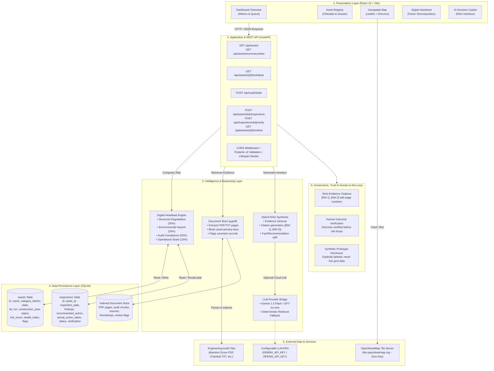

# AAYAM — Technical Architecture Documentation

> **AI-Powered Public Infrastructure Intelligence Layer**
> Full-Stack Hackathon Prototype: Milestone 1–4 Technical Architecture & Engineering Specifications.

---

## Architecture Diagram (Mermaid)

---

## Layer-by-Layer Technical Breakdown

### 1. Presentation Layer (User Interface)
- **Technologies:** React 19, Vite 8, Tailwind CSS 3.4, Leaflet 1.9, React-Leaflet 5.0, Lucide Icons.
- **Responsibilities:**
  - Fast Single Page Application (SPA) with responsive, dark-mode design system.
  - Interactive geospatial map with dynamic color-coded pins (Red: Critical, Amber: Requires Inspection, Green: Operational) and dual-action navigation popups.
  - Multi-tab Digital Heartbeat inspection dashboard showing live 4-factor risk decomposition.
  - Full closed-loop workflow UI: Record inspection &rarr; track action &rarr; verify outcome with certified notes.
  - Transparent RAG copilot interface with clickable inquiry verification cards and inline citation badges.

### 2. Application & REST API Layer (FastAPI)
- **Technologies:** FastAPI 0.119, Starlette, Uvicorn, Pydantic v2.
- **Responsibilities:**
  - High-concurrency asynchronous REST endpoints.
  - Pydantic v2 request/response validation ensuring strict schema enforcement.
  - CORS middleware allowing local frontend dev server (`http://localhost:5173`) and Vite proxy.
  - Application Lifespan context: automatically initializes SQLite tables and seed data on initial startup without requiring manual database migration steps.

### 3. Intelligence & Reasoning Layer
- **Components:**
  - **Explainable Digital Heartbeat Engine (`heartbeat_engine.py`):** Calculates multi-factor risk:
    $$\text{Risk Score} = 0.35 \times \text{Structural} + 0.25 \times \text{Environmental} + 0.25 \times \text{Compliance} + 0.15 \times \text{Operational}$$
    $$\text{Structural Health Index} = \max(10, \min(100, 100 - (0.65 \times \text{Structural} + 0.35 \times \text{Operational})))$$
    Dynamic recalculation triggered immediately whenever field inspections or verified interventions are recorded.
  - **Evidence Ingestion Engine (`document_store.py`):** Uses `pypdf` to extract text from multi-page PDFs and technical TXT memos. Automatically associates documents to assets via validated primary keys; unverified documents are safely flagged for human review.
  - **Hybrid RAG Pipeline (`copilot_service.py`):** Searches structured entity attributes and indexed document text. Produces grounded answers with source citations (`[Ref 1]`, `[Ref 2]`). Separates empirical facts from recommendations.
  - **LLM Provider Bridge:** Seamlessly integrates with Google Gemini (`GEMINI_API_KEY`) or OpenAI (`OPENAI_API_KEY`) when configured, with automatic fallback to deterministic retrieval-only rule synthesis when no API key is set.

### 4. Data Persistence Layer
- **Technologies:** SQLite 3, SQLAlchemy 2.0 ORM.
- **Tables & Stores:**
  - `assets`: Stores primary key, name, category, district, state, coordinates, construction year, status, risk score, health index, flagged reasons, and data source.
  - `inspections`: Stores unique inspection IDs, foreign key to asset, audit dates, inspection type, findings, recommended action, actual action taken, workflow status (`Pending`, `In Progress`, `Completed`, `Verified`), verification notes, and certifying engineer.
  - `DocumentStore`: In-memory indexed evidence chunk collection preserving document title, file format, page numbers, timestamps, and agency sources.

### 5. External Services & Repositories
- **OpenStreetMap:** Permitted standard tile provider (`https://tile.openstreetmap.org/{z}/{x}/{y}.png`) requiring zero API keys and adhering to OSM usage policies.
- **Engineering Documents:** Authentic inspection reports (Mandovi Bridge Scour PDF, Chambal WTP Vibration TXT, Western Ghats Hydrology TXT, Mithi Sluice Gate TXT).
- **LLM APIs (Optional):** Gemini 1.5 Flash or GPT-4o-mini for conversational rephrasing when configured via environment variables.

### 6. Governance, Trust & Safety
- **Zero-Hallucination Design:** Grounded strictly in verified database rows and document excerpts.
- **Fact vs. Recommendation Boundary:** Observed telemetry is strictly separated from recommended interventions.
- **Human-in-the-Loop Outcome Verification:** Risk scores are not marked safe merely because an action was logged; an explicit verification sign-off is required before risk credit is awarded.
- **Transparent Disclaimers:** All sample data is explicitly labeled as synthetic prototype records; never misrepresented as live government telemetry.

---

## Presentation Deliverables

- **PowerPoint Slide:** [`architecture/AAYAM_Technical_Architecture.pptx`](file:///Users/vasanthkumarsv/Desktop/AAYAM%20PROJECT/architecture/AAYAM_Technical_Architecture.pptx) (16:9 widescreen, editable shapes, clean color hierarchy).
- **Vector SVG Diagram:** [`architecture/AAYAM_Technical_Architecture.svg`](file:///Users/vasanthkumarsv/Desktop/AAYAM%20PROJECT/architecture/AAYAM_Technical_Architecture.svg) (High-contrast, scalable vector illustration).

---

## One-Minute Technical Presentation Script

> "Good morning, judges. Public infrastructure failures rarely happen overnight — they stem from disconnected audit records, missed inspection cycles, and unexplainable data silos.
>
> We built **AAYAM** — an AI-powered Infrastructure Intelligence Layer for India's public works.
>
> At its core is the **Digital Heartbeat**: a transparent mathematical model that derives asset risk from four explainable dimensions: structural material degradation, environmental climate hazard, audit compliance recency, and operational load.
>
> When an engineer asks our **AI Decision Copilot** why an asset is flagged, AAYAM runs an evidence-grounded RAG pipeline. It searches our SQLite database and parses multi-page engineering inspection PDFs using `pypdf`, providing exact citations down to the document name and page number — while strictly separating observed facts from recommended remediation.
>
> Best of all, AAYAM implements a **closed-loop workflow**: Detect, Understand, Prioritize, Intervene, and Verify. When field engineers execute repairs and certify the outcome, our Digital Heartbeat dynamically recalculates the asset's risk score in real time.
>
> Everything you see today is fully implemented, running on FastAPI, React, and OpenStreetMap. Thank you."

---

## Five Likely Technical Judge Questions & Accurate Answers

### Question 1: "How does your RAG pipeline prevent hallucinations when answering infrastructure safety questions?"
**Answer:**
"AAYAM uses a strict evidence-grounded architecture. Before any answer is generated, the pipeline queries structured SQLite asset records and indexed PDF/TXT audit documents using `pypdf`. The context is assembled with explicit citation identifiers (`[Ref 1]`, `[Ref 2]`). When an LLM is active, the system prompt strictly constrains generation to retrieved evidence and enforces a clear separation between observed facts and recommendations. If no records match, the system explicitly returns `matched_assets_count: 0` and declares insufficient evidence rather than guessing. Furthermore, if no external LLM API key is configured, AAYAM executes a deterministic rule-based retrieval synthesis with zero generative hallucination."

### Question 2: "Why did you choose a mathematical rules-based approach for the Digital Heartbeat rather than training a machine learning model?"
**Answer:**
"In public civil infrastructure, explainability and regulatory defensibility are paramount. A black-box ML model cannot easily justify why a bridge was restricted to 30 km/h in a court of inquiry. Our Digital Heartbeat breaks risk into four auditable, weighted engineering factors: Structural Degradation (35%), Environmental Hazard (25%), Compliance Recency (25%), and Operational Strain (15%). Every point added or subtracted is tied to an underlying record, such as days elapsed since certified audit or verified crack propagation. In future phases, machine learning will be layered on top of this deterministic baseline for predictive time-to-failure forecasting."

### Question 3: "How does your closed-loop verification prevent fraudulent or premature closure of safety warnings?"
**Answer:**
"AAYAM explicitly separates recording an action from verifying its outcome. When a maintenance team logs an action taken (e.g. 'Boulder dumping contracted'), the status transitions to 'In Progress', but the asset's critical status remains unmitigated. Only when an authorized certifying engineer conducts a post-intervention inspection and submits certified verification notes via `POST /api/inspections/{id}/verify` does the engine recalculate the asset's Digital Heartbeat and lower the risk tier. This ensures strict human-in-the-loop governance."

### Question 4: "How do you handle documents that cannot be reliably matched to an infrastructure asset?"
**Answer:**
"Our `DocumentStore` implements strict entity linking. When parsing documents, it searches for validated asset primary keys (such as `ASSET-BRG-001`). If a document lacks a verified asset identifier — such as our sample regional river dredging circular — the system refuses to guess. Instead, it marks `needs_review: true` with an explicit reason: 'Uncertain asset relationship: General regional memo without specific individual asset binding'. This ensures that unverified circulars are never falsely attributed to specific structural assets."

### Question 5: "What are your storage and scaling strategies if this prototype expands to millions of assets across national highways and municipal bodies?"
**Answer:**
"While SQLite and local document storage are optimal for this zero-config hackathon prototype, our architecture is cleanly decoupled:
1. The SQLAlchemy ORM layer can be repointed to PostgreSQL / PostGIS with zero changes to business logic for spatial querying.
2. Inverted file indexing in `DocumentStore` can be transitioned to an enterprise vector store like pgvector or ChromaDB with chunk embeddings.
3. The FastAPI stateless application layer is containerizable via Docker and horizontally scalable behind a load balancer with Redis caching for hot Digital Heartbeat queries."
